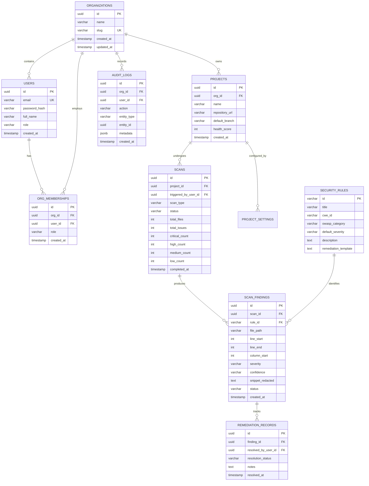

# Database Schema Specification
**Product**: Voom Nexus — Vibe Security Tool  
**Target RDBMS**: PostgreSQL 16+  
**ORM / Query Layer**: Prisma / Kysely  
**Document Version**: 1.0.0  

---

## 1. Multi-Tenant Architecture & Data Isolation

Voom Nexus employs a **Row-Level Tenant Isolation** model:
- All core tenant entities (`projects`, `scans`, `vulnerabilities`, `audit_logs`) are bound to an `organization_id`.
- Foreign key constraints enforce strict referential integrity.
- PostgreSQL Row-Level Security (RLS) policies are configured so database queries automatically scope results to the requesting user's active organization ID, preventing cross-tenant information disclosure (CWE-639 / BOLA).

---

## 2. Entity-Relationship Diagram (ERD)



---

## 3. Detailed Table Definitions & Constraints

### 3.1 `organizations`
Represents an enterprise customer, team, or academic department.
```sql
CREATE TABLE organizations (
    id UUID PRIMARY KEY DEFAULT gen_random_uuid(),
    name VARCHAR(255) NOT NULL,
    slug VARCHAR(100) NOT NULL UNIQUE,
    created_at TIMESTAMPTZ NOT NULL DEFAULT NOW(),
    updated_at TIMESTAMPTZ NOT NULL DEFAULT NOW()
);

CREATE INDEX idx_organizations_slug ON organizations(slug);
```

### 3.2 `users` & `org_memberships`
Handles authentication, identity, and organization-scoped authorization.
```sql
CREATE TABLE users (
    id UUID PRIMARY KEY DEFAULT gen_random_uuid(),
    email VARCHAR(255) NOT NULL UNIQUE,
    password_hash VARCHAR(255) NOT NULL,
    full_name VARCHAR(255) NOT NULL,
    is_active BOOLEAN NOT NULL DEFAULT TRUE,
    created_at TIMESTAMPTZ NOT NULL DEFAULT NOW(),
    updated_at TIMESTAMPTZ NOT NULL DEFAULT NOW()
);

CREATE TABLE org_memberships (
    id UUID PRIMARY KEY DEFAULT gen_random_uuid(),
    organization_id UUID NOT NULL REFERENCES organizations(id) ON DELETE CASCADE,
    user_id UUID NOT NULL REFERENCES users(id) ON DELETE CASCADE,
    role VARCHAR(50) NOT NULL CHECK (role IN ('ADMIN', 'MAINTAINER', 'MEMBER', 'AUDITOR')),
    created_at TIMESTAMPTZ NOT NULL DEFAULT NOW(),
    UNIQUE (organization_id, user_id)
);

CREATE INDEX idx_org_memberships_user ON org_memberships(user_id);
CREATE INDEX idx_org_memberships_org ON org_memberships(organization_id);
```

### 3.3 `projects`
A monitored codebase or repository.
```sql
CREATE TABLE projects (
    id UUID PRIMARY KEY DEFAULT gen_random_uuid(),
    organization_id UUID NOT NULL REFERENCES organizations(id) ON DELETE CASCADE,
    name VARCHAR(255) NOT NULL,
    slug VARCHAR(100) NOT NULL,
    repository_url VARCHAR(1024),
    default_branch VARCHAR(100) DEFAULT 'main',
    health_score INT NOT NULL DEFAULT 100 CHECK (health_score BETWEEN 0 AND 100),
    created_at TIMESTAMPTZ NOT NULL DEFAULT NOW(),
    updated_at TIMESTAMPTZ NOT NULL DEFAULT NOW(),
    UNIQUE (organization_id, slug)
);

CREATE INDEX idx_projects_org ON projects(organization_id);
```

### 3.4 `scans`
Records each scanning execution initiated via CLI sync, Web UI, or CI/CD webhook.
```sql
CREATE TABLE scans (
    id UUID PRIMARY KEY DEFAULT gen_random_uuid(),
    project_id UUID NOT NULL REFERENCES projects(id) ON DELETE CASCADE,
    triggered_by_user_id UUID REFERENCES users(id) ON DELETE SET NULL,
    scan_type VARCHAR(50) NOT NULL CHECK (scan_type IN ('CLI_LOCAL', 'CI_CD', 'WEB_UPLOAD', 'GIT_SYNC')),
    status VARCHAR(50) NOT NULL CHECK (status IN ('PENDING', 'RUNNING', 'COMPLETED', 'FAILED', 'CANCELLED')),
    commit_sha VARCHAR(64),
    branch VARCHAR(100),
    total_files INT NOT NULL DEFAULT 0,
    total_issues INT NOT NULL DEFAULT 0,
    critical_count INT NOT NULL DEFAULT 0,
    high_count INT NOT NULL DEFAULT 0,
    medium_count INT NOT NULL DEFAULT 0,
    low_count INT NOT NULL DEFAULT 0,
    duration_ms INT NOT NULL DEFAULT 0,
    error_message TEXT,
    created_at TIMESTAMPTZ NOT NULL DEFAULT NOW(),
    completed_at TIMESTAMPTZ
);

CREATE INDEX idx_scans_project ON scans(project_id, created_at DESC);
```

### 3.5 `security_rules`
Reference table containing metadata for all detection rules in `@voom-nexus/rules`.
```sql
CREATE TABLE security_rules (
    id VARCHAR(50) PRIMARY KEY, -- e.g. 'SEC-JS-001'
    title VARCHAR(255) NOT NULL,
    cwe_id VARCHAR(50) NOT NULL, -- e.g. 'CWE-89'
    owasp_category VARCHAR(100) NOT NULL, -- e.g. 'A03:2021-Injection'
    default_severity VARCHAR(20) NOT NULL CHECK (default_severity IN ('CRITICAL', 'HIGH', 'MEDIUM', 'LOW', 'INFORMATIONAL')),
    description TEXT NOT NULL,
    remediation_template TEXT NOT NULL,
    created_at TIMESTAMPTZ NOT NULL DEFAULT NOW()
);
```

### 3.6 `scan_findings`
Stores discovered vulnerabilities. Sensitive tokens are always redacted prior to insertion.
```sql
CREATE TABLE scan_findings (
    id UUID PRIMARY KEY DEFAULT gen_random_uuid(),
    scan_id UUID NOT NULL REFERENCES scans(id) ON DELETE CASCADE,
    rule_id VARCHAR(50) NOT NULL REFERENCES security_rules(id),
    file_path VARCHAR(1024) NOT NULL,
    line_start INT NOT NULL,
    line_end INT NOT NULL,
    column_start INT,
    column_end INT,
    severity VARCHAR(20) NOT NULL CHECK (severity IN ('CRITICAL', 'HIGH', 'MEDIUM', 'LOW', 'INFORMATIONAL')),
    confidence VARCHAR(20) NOT NULL CHECK (confidence IN ('CERTAIN', 'FIRM', 'TENTATIVE')),
    snippet_redacted TEXT NOT NULL,
    status VARCHAR(50) NOT NULL DEFAULT 'OPEN' CHECK (status IN ('OPEN', 'FIXED', 'FALSE_POSITIVE', 'IGNORED')),
    created_at TIMESTAMPTZ NOT NULL DEFAULT NOW()
);

CREATE INDEX idx_findings_scan ON scan_findings(scan_id);
CREATE INDEX idx_findings_rule ON scan_findings(rule_id);
CREATE INDEX idx_findings_severity ON scan_findings(severity);
```

### 3.7 `audit_logs`
Immutable compliance and security activity trail.
```sql
CREATE TABLE audit_logs (
    id UUID PRIMARY KEY DEFAULT gen_random_uuid(),
    organization_id UUID NOT NULL REFERENCES organizations(id) ON DELETE CASCADE,
    user_id UUID REFERENCES users(id) ON DELETE SET NULL,
    action VARCHAR(100) NOT NULL,
    entity_type VARCHAR(50) NOT NULL,
    entity_id UUID,
    metadata JSONB NOT NULL DEFAULT '{}'::jsonb,
    ip_address INET,
    user_agent TEXT,
    created_at TIMESTAMPTZ NOT NULL DEFAULT NOW()
);

CREATE INDEX idx_audit_logs_org_date ON audit_logs(organization_id, created_at DESC);
```
