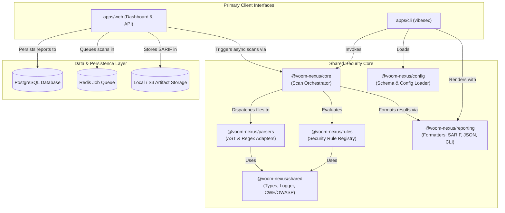
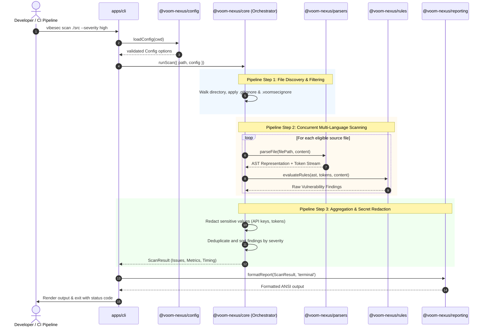
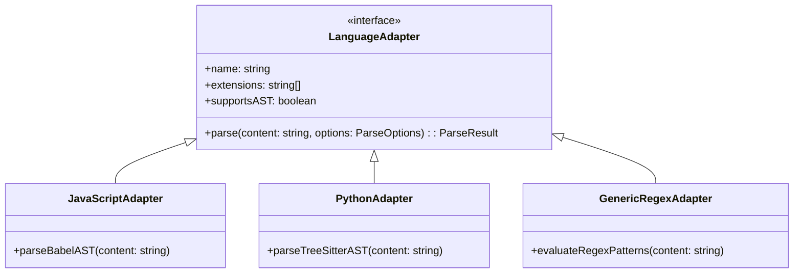
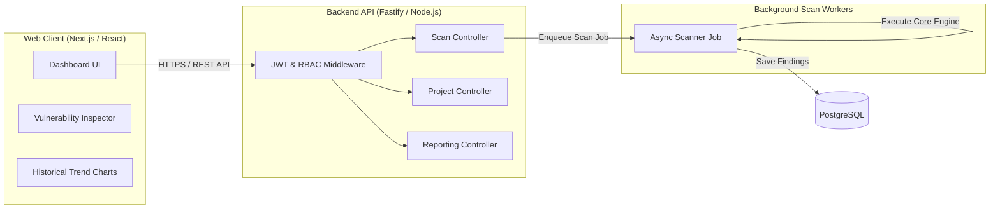
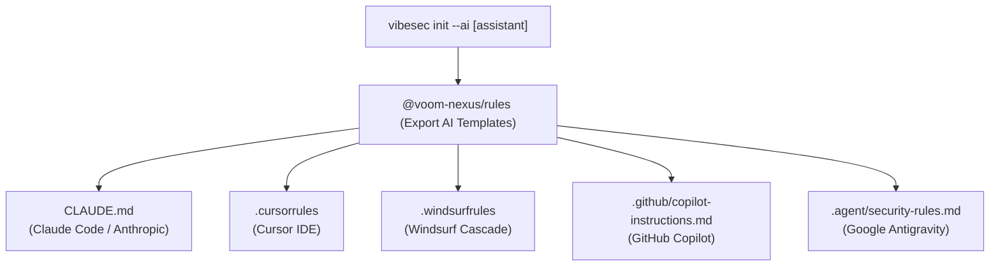

# System Architecture Document
**Product**: Voom Nexus — Vibe Security Tool  
**Document Version**: 1.0.0  
**Status**: Architecture Approved  

---

## 1. High-Level Architectural Overview

Voom Nexus is structured as a **modular monorepo** containing two client applications (CLI and Web) powered by an independent, shared security analysis engine.

---

## 2. Monorepo Package Boundaries & Responsibilities

| Package / App | Responsibility | Dependencies |
| :--- | :--- | :--- |
| **`apps/cli`** | Interactive terminal tool, argument parsing, spinner display, local file walking, exit codes. | `@voom-nexus/core`, `@voom-nexus/config`, `@voom-nexus/reporting`, `@voom-nexus/shared` |
| **`apps/web`** | Web dashboard frontend (React/Tailwind) & API server (Fastify/Node.js) for scan ingestion and reporting. | `@voom-nexus/core`, `@voom-nexus/reporting`, `@voom-nexus/shared` |
| **`packages/core`** | Scan pipeline orchestrator, file tree traverser, concurrent worker manager, finding aggregator. | `@voom-nexus/rules`, `@voom-nexus/parsers`, `@voom-nexus/shared` |
| **`packages/rules`** | Definitions, CWE/OWASP metadata, AST node matching logic, regex patterns, and remediation templates. | `@voom-nexus/shared` |
| **`packages/parsers`** | Language-specific AST parser adapters (Babel, Tree-sitter) and tokenizer abstractions. | `@voom-nexus/shared` |
| **`packages/config`** | Zod schema validation for `.voomsecrc.json`, `.voomsecignore`, and runtime options. | `@voom-nexus/shared` |
| **`packages/reporting`** | Report formatting drivers: Terminal Pretty-Print, JSON, SARIF v2.1.0, Markdown summary. | `@voom-nexus/shared` |
| **`packages/shared`** | Universal TypeScript types, severity enums, logger abstraction, redaction helpers. | *None (zero internal dependencies)* |

---

## 3. The Core Scan Pipeline (Orchestration Sequence)

The scanning process is deterministic and completely isolated from code execution:

---

## 4. Language Adapter Architecture

To support 9+ programming languages without coupling, the parser architecture uses a unified adapter contract:

1. **AST-Capable Adapters**: Convert code into an Abstract Syntax Tree (AST), enabling precise syntactic queries (e.g., checking if `db.query()` receives a binary string concatenation instead of a parameterized variable).
2. **Regex/Heuristic Adapters**: Execute pre-compiled, ReDoS-safe regular expressions for languages where full AST overhead is unnecessary or during early-stage language rollout.

---

## 5. Web Application Architecture (`apps/web`)

The Web interface provides multi-project security governance:

---

## 6. AI Assistant Security Guideline Integration

Voom Nexus injects defensive constraints into AI coding assistants using the `vibesec init` command:

Each generated rule file translates OWASP Top 10 negative constraints into assistant-specific syntax, instructing LLMs to:
1. Always use parameterized queries for database operations.
2. Avoid `dangerouslySetInnerHTML`, `innerHTML`, and `eval()`.
3. Require cryptographic algorithms like `argon2id` and `AES-256-GCM`.
4. Refuse to generate raw hardcoded API keys or placeholder passwords.
